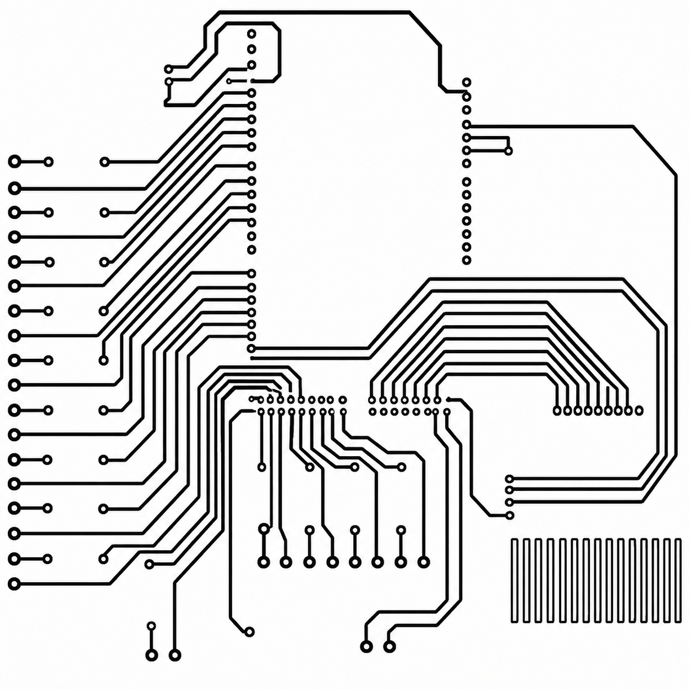
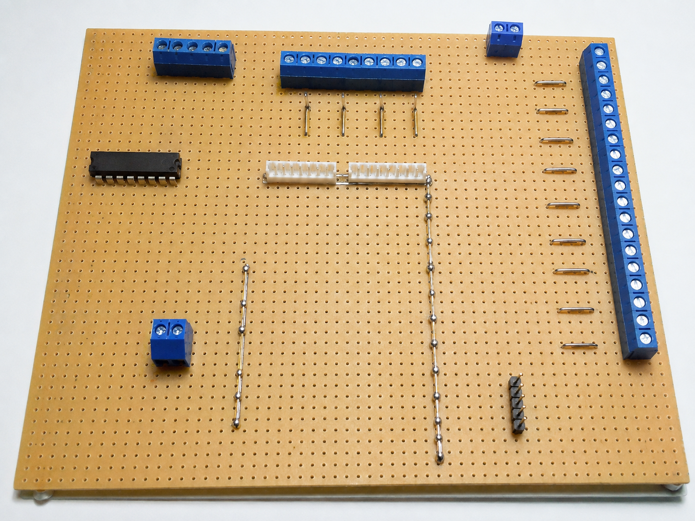
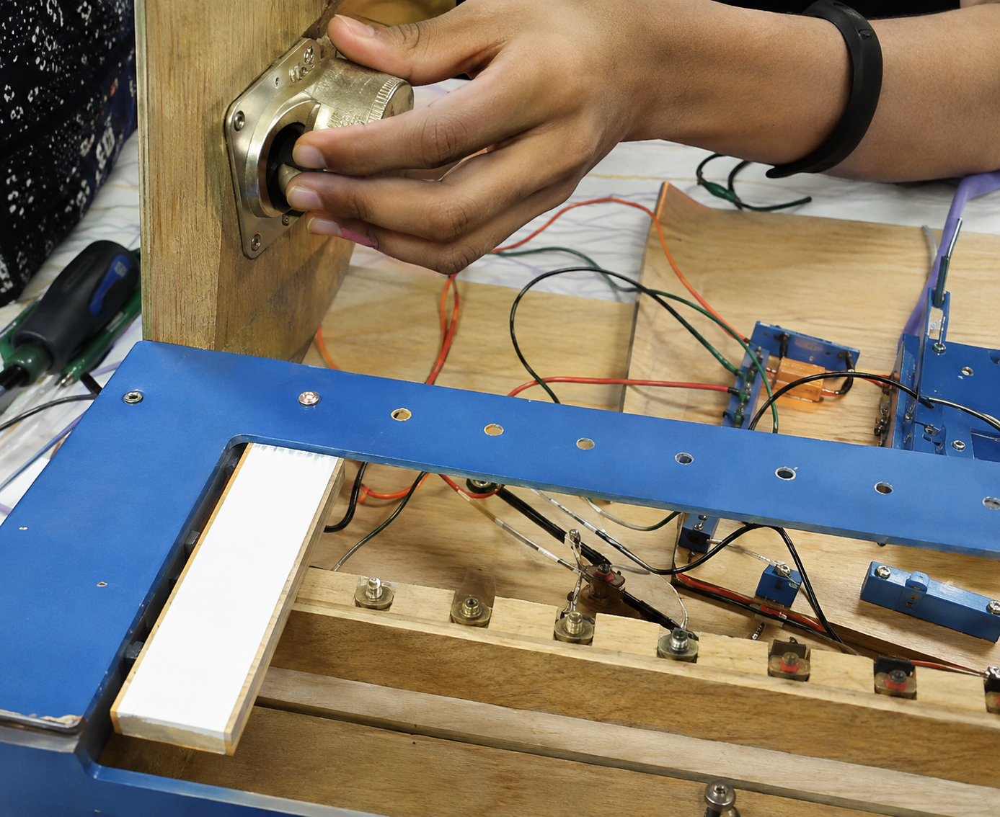
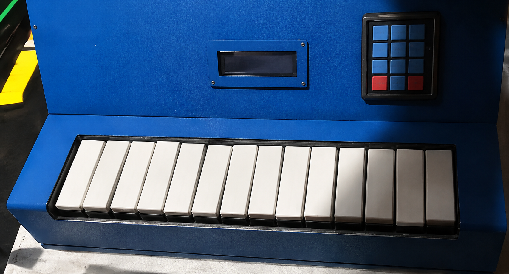

# Piano Digital Embarcado

Protótipo de piano digital que transforma entradas de teclado em resposta
eletrônica com LCD, LEDs e circuitaria dedicada. Desenvolvido durante o
curso Técnico em Mecatrônica (ETEP).

> 🚧 **Repositório em reconstrução.** O código-fonte original deste
> projeto ainda está sendo recuperado. Este README documenta o
> funcionamento e o escopo do protótipo; o firmware será adicionado assim
> que localizado.

## 🎯 Descrição do Projeto

A experiência de tocar depende de ler comandos físicos com consistência e
devolver uma resposta imediata que una som, indicação visual e informação
no display. O sistema mapeia as entradas do teclado para notas musicais e
coordena a saída eletrônica, o LCD e os LEDs como uma única interface
musical — unindo leitura de entradas, lógica de firmware, resposta visual
e uma placa de circuito dedicada.

## 🔁 Resposta a Cada Nota

1. Tecla pressionada
2. Leitura de entrada
3. Mapeamento da nota
4. Som e LEDs correspondentes
5. LCD atualiza

## 🖼️ Visão do Projeto

  
  
  
  

## 🔧 Componentes de Hardware

- **Arduino** (unidade de controle)
- **Teclado** (entrada de notas)
- **Display LCD** (informação em tempo real)
- **LEDs** (sinalização visual)
- **PCB dedicada** (circuito impresso do projeto)

## 🛠️ Stack

`Arduino` · `C/C++` · `LCD` · `LEDs` · `PCB`

## 📦 Entregáveis do Protótipo

- Firmware Arduino
- Integração de LCD
- Sinalização visual por LEDs
- Protótipo eletrônico com placa de circuito dedicada

## 🎓 Contexto

Projeto desenvolvido durante o curso **Técnico em Mecatrônica** na
**ETEP**, como parte da formação em eletrônica, circuitos digitais e
desenvolvimento de placas de circuito impresso.

## 🤝 Autor

Desenvolvido por **Gustavo Nascimento**.
